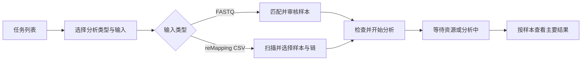

# SCigblast Web 与 Pipeline 优化实施方案

日期：2026-10-05。检索基线：`main` / `c2b29b3`。

用户随后批准实施；2026-10-05 的实际交付与验收记录见第 8 节。第 1–7 节保留原设计及证据。

面向实验与数据分析人员：默认操作清晰、结果易找，技术详情折叠。建议依次完成“结果与执行状态可靠 → 常用操作易理解 → 基于实测改善性能”。沿用 FastAPI、Jinja2、原生 JavaScript 和 SQLite。

本轮仅检索、设计及写入本方案。检查范围是注册表中的 IR、10X、Base、Pig、reMapping，以及 Web 创建、审核、运行、结果与部署配置。未启动浏览器、SSH 或真实 pipeline；下列“代码确认”指可由当前实现确定的缺口，“待验证”不等于已发生故障。

## 1. 已有基础与必须保留的行为

- 上轮已完成任务列表分页/操作者筛选、Match 请求防乱序、10X reducer 重建和 stage8 内存优化、Base/Pig 阶段产物检查、四条 FASTQ runner 的 cgroup 内存识别、IR futures 限流及 reMapping CSV 流式转换。本轮在这些实现上补缺口。
- 保留单 Web 实例、单 Uvicorn worker、Web 同时运行一条 pipeline，以及五条正式 runner 共享的资源锁。阶段内部并行单独调优。
- reMapping 仍只支持 human；CSV 命名为 `<sample>__<chain>.csv`，要求 `CDR3(pep)`、`copy`、`joinedSeq`；样本默认全选，支持链和样本选择，不引入 Submission / Match。
- 保留当前链默认值：发现 IGH 时默认勾选 IGH；没有 IGH 时提示选择链。提交前清楚展示实际的“所选样本 × 所选链”交集。
- reMapping FASTA 不展示、不提供下载；主要结果是各样本的 UMI count 表。02、03 输出均为已筛选的 TSV，不再分 raw/filtered，不新增文件后缀。
- UMI count 从 FASTA 标识最后一个下划线字段还原原 CSV 的 `copy`；不改成第二字段，不重新做 UMI 聚类，不改变过滤条件、计数口径或输出目录层级。

## 2. 优先问题与证据

### P1：影响结果可信度与运行判断

**A1. Base/Pig 缓存没有完整覆盖实际参考库和工具依赖〔代码确认〕**

Base 的子任务签名只有 FASTA 元数据、链、物种、线程数及固定过滤版本；Pig 只比较 FASTA 大小和修改时间。更换数据库、aux 或 IgBLAST 程序后，续跑可能复用旧比对结果。外层 stage DONE 同样需要纳入依赖变化，否则仅修子任务签名仍可能整阶段跳过。

证据：[Base 子任务缓存](/E:/Desktop/project/SCigblast/Igblast_base/pipeline/05.work_igblastn.sh:127)、[Pig 子任务缓存](/E:/Desktop/project/SCigblast/PigIgblast/pipeline/05.work_igblastn.py:83)、[Base 阶段签名](/E:/Desktop/project/SCigblast/Igblast_base/pipeline/run_igblast_base.sh:226)、[Pig 阶段签名](/E:/Desktop/project/SCigblast/PigIgblast/pipeline/run_pig_pipeline.sh:289)。

设计：每次运行解析实际工具、所选链的数据库文件、aux、相关参数及过滤版本，形成可复用依赖签名；同时写入 stage 和 task 标记。沿用 reMapping 已有的文件元数据签名思路，加上明确的数据库版本标识。旧标记缺少新版字段时失效一次；相同依赖下保持断点复用。不在每个任务或 Web 请求中重新哈希整个数据库。

**A2. Base/Pig 本次整组失败时，可能留下上次的样本聚合结果〔代码确认〕**

两者只给“本次至少有一个成功子任务”的组重建 `BCR.tsv` / `TCR.tsv`。一个组之前成功、本次所有链失败时，旧聚合文件仍留在正式路径；虽然本次 stage 会失败，人工读取该路径仍可能误取旧结果。

证据：[Base 聚合发布](/E:/Desktop/project/SCigblast/Igblast_base/pipeline/05.work_igblastn.sh:186)、[Pig 聚合发布](/E:/Desktop/project/SCigblast/PigIgblast/pipeline/05.work_igblastn.py:144)。

设计：先由当前 manifest 确定本次应发布的聚合路径，使这些路径上的旧聚合失效；成功子任务输出仍保留作断点缓存。新聚合及汇总均写临时文件、完成后原子替换。整组失败不发布旧聚合；部分链成功时沿用当前成功链汇总行为，并明确显示失败链及结果不完整。失效/清理仅覆盖该 runner 管理的当前聚合路径，不递归删除整个 stage 或输入目录。

**A3. 重试时日志和进度可能来自上一次执行〔代码确认〕**

日志接口优先读取已有 `pipeline.log`，只有它不存在才读取本次 `launcher-<attempt>.log`。因此，续跑等待共享锁或在初始化阶段失败时可能仍显示旧日志；进度解析也读同一个旧日志尾部。

证据：[日志选择](/E:/Desktop/project/SCigblast/web/app.py:1486)、[进度解析](/E:/Desktop/project/SCigblast/web/app.py:595)、[启动与 attempt 更新](/E:/Desktop/project/SCigblast/web/app.py:642)、[资源锁等待输出](/E:/Desktop/project/SCigblast/pipeline_resource_lock.sh:26)。

设计：明确本次 attempt 的启动时间、启动日志和运行日志边界。启动失败也要记录一次尝试及可见错误。默认展示本次启动/运行内容，历史日志放入高级详情；保留已验证完成的阶段，但不得从旧 attempt 日志推导当前阶段内进度。增加“等待运行资源”说明，与 Web 排队、实际分析区分；不必为此重写整个状态机。

### P2：明确缺陷、性能开销和理解成本

| 编号 | 发现、触发与影响 | 实施方向 |
| --- | --- | --- |
| B1 | **Base 汇总的 `output_path` 声明后未赋值。** task 只有 `path`，写 CSV 时 `output_path` 为空；阶段校验又要求非空。成功续跑仍重新进入 IgBLAST stage 执行器，重复计数、缓存检查及聚合，不代表每次都重新比对。[写汇总](/E:/Desktop/project/SCigblast/Igblast_base/pipeline/05.work_igblastn.sh:194)、[校验](/E:/Desktop/project/SCigblast/Igblast_base/pipeline/run_igblast_base.sh:323)。 | 按 Pig 已有实现填写真实子任务 `output_path`；与阶段校验使用同一契约，补“首次成功后第二次确实跳过”的集成回归。 |
| B2 | **普通结果分页仍全表扫描，并套用 Match 状态统计。** 无 `status` 列的 AIRR 被计作 error；每次翻页还构建 Match 专用集合。[读取器](/E:/Desktop/project/SCigblast/web/app.py:859)、[reMapping 样本预览入口](/E:/Desktop/project/SCigblast/web/app.py:817)、[调用](/E:/Desktop/project/SCigblast/web/app.py:1258)。 | 拆分 Match 审核统计与普通预览；无状态列时不返回虚假 error 数。普通首屏有界读取，完成结果的总数复用摘要，详见第 4 节。 |
| B3 | **刷新失败不可见。** 列表请求失败写入关闭的新建抽屉；详情轮询失败只进控制台。用户可能把旧状态当作实时状态。[列表](/E:/Desktop/project/SCigblast/web/static/index.js:198)、[详情](/E:/Desktop/project/SCigblast/web/static/job.js:186)。 | 列表、详情各有独立的连接提示、最近成功时间及重试入口；保留最后成功数据。 |
| B4 | **预检与实际启动脱节。** “检查”显示缺工具/库，但创建流程没有复用统一阻断结果；非 mapping 预检没有核对实际链数据库。[预检](/E:/Desktop/project/SCigblast/web/app.py:1065)、[前端检查/提交](/E:/Desktop/project/SCigblast/web/static/index.js:203)、[创建](/E:/Desktop/project/SCigblast/web/app.py:1289)。 | 按本次即将执行阶段做服务端检查：FASTQ 可先做 Match；确认分析、续跑和真正出队启动时检查所需依赖；reMapping 创建时直接检查。 |
| B5 | **reMapping 并发只使用配置预算。** `min(300, 配置值)` 没有读取实际容器内存限制；配置中的单任务内存值用于计算 worker 数，并不是硬限额。[并发计算](/E:/Desktop/project/SCigblast/mapping/pipeline/run_mapping.py:174)。 | 补实际可用资源识别；预算不足时明确阻断，不强行分配一个 worker。已存在于其他 FASTQ runner 的能力不重复改写。 |
| B6 | **ARCHIVING 在状态分类中漏项。** 归档期间既不属于“进行中”也不属于“已完成”，只能在“全部”找到。[后端统计](/E:/Desktop/project/SCigblast/web/app.py:1460)、[前端筛选](/E:/Desktop/project/SCigblast/web/static/index.js:198)。 | 统一归入“进行中”展示，并标“正在归档”；该 UI 分类不改变分析运行位的计数。 |
| B7 | **部署并发说明不一致。** 实际固定为 1，`.env.example` 和 AGENT 却写 2。[实际值](/E:/Desktop/project/SCigblast/web/app.py:46)、[环境示例](/E:/Desktop/project/SCigblast/web/.env.example:6)、[AI 文档](/E:/Desktop/project/SCigblast/AGENT.md:19)。 | 删除或明确废弃无效的并发配置示例；文档统一说明串行调度、阶段内部并行及共享锁。 |

B2 已做只读内存复现：对 1,000 行、只有 `sequence_id/v_call` 的 TSV 请求 5 行，返回 5 行，但 `counts.total=1000`、`counts.error=1000`。这证明读取和 API 统计问题；不表示当前所有页面都会把这个 error 数展示给用户，也不构成生产性能基准。

### 需要定向验证的项目

- **Web 单进程重启后的旧 runner 存活。** `start_new_session=True` 启动子进程；启动恢复只把运行中任务改为 INTERRUPTED，resume 未核验原 PGID。见 [恢复](/E:/Desktop/project/SCigblast/web/app.py:718)、[续跑](/E:/Desktop/project/SCigblast/web/app.py:1571)。共享 flock 通常阻止重阶段同时执行；风险是新进程排队、旧进程仍执行，而停止只针对新进程。先在实际部署模型复现“仅 Web 进程重启”与“整个容器重启”的区别。若旧组能存活，持久化并核验 PID/PGID、进程启动标识和任务归属；旧执行未结束时不新建 attempt，提供停止该次执行的操作。身份不能确认时不得凭旧 PID 杀进程。
- **详情状态请求乱序。** [refresh()](/E:/Desktop/project/SCigblast/web/static/job.js:34) 没有列表、Match 已有的请求版本保护。用可控延迟复现“旧轮询晚于停止/续跑返回”，再增加请求世代校验，动作开始时使旧轮询失效。日志已有 `logBusy`，不重复增加同类锁。
- **文件选择器叠加抽屉的模态语义。** 两处都声明 modal，需键盘和读屏确认焦点范围；见 [模板](/E:/Desktop/project/SCigblast/web/templates/index.html:40)。统一最上层对话框的焦点约束，关闭后恢复到原触发按钮。

## 3. 默认操作流程与界面设计

**任务列表：先看到是否需要处理。** 保留已有操作者、流程、搜索与分页。突出任务名称、流程、状态和下一步；成功使用“查看结果”，待审核使用“核对样本”，失败显示简短原因和“查看原因 / 续跑”。把当前“已完成”筛选改为“已结束”，因为它包含失败、停止和中断；真实成功状态仍叫“已完成”。状态不能只用颜色区分。筛选后清楚区分“全部可见任务统计”与“本次筛选数量”。

**创建任务：在现有抽屉中分三段。** 依次为“分析类型 → 输入与处理范围 → 检查并创建”，不要求重做为多路由向导。流程卡片增加一句适用输入和最终产物说明；必要字段始终可见，物种固定值、路径详情、资源设置等按需展开。输入路径旁明确“服务器目录”，提供现有文件选择器。IR 自动识别需展示识别结论和下一步，而不只留一个 auto 值。

字段检查显示在字段旁并聚焦首个错误；用 `aria-invalid`、文字和图标同步表达状态。现有路径圆点要么接入检查结果，要么移除，不能一直呈现无反馈状态。IR/10X 空 Barcode 当前会回退系统默认文件，应显示“使用默认 Barcode”及实际来源，而不是强加前端必填限制。路径或样本选择变化后，旧检查结果立即失效。

服务端检查返回明确的字段/阶段、错误代码和阻断级别。用户看到“所选 TRB 参考库不可用，请联系管理员”，技术详情再展开真实路径及工具输出。检查仅针对当前操作依赖；确认任务时再次核对，不信任浏览器曾经检查通过的状态。reMapping 预检去掉已不使用的依赖要求，检查实际运行的解释器和工具环境。

**reMapping 范围：展示实际会运行什么。** 保留样本全选、相对路径区分同名样本、链多选；汇总显示“发现 N 个样本，已选 M 个，实际处理 K 个样本/链文件”。不具备所选链的样本注明“本次不处理”；交集为空时就地说明。无 IGH 的输入直接提示“请选择要处理的链”。未识别文件显示数量和可展开原因。更换路径必须重新扫描。

**Match 审核：将审核标注与是否进入分析分开解释。** 按现有 OK/ERROR 决定下游范围；“待补资料”是注释，不偷偷改变纳入规则。确认区展示“将进入分析 X 条、ERROR 排除 Y 条、待补资料标注 Z 条”，行数与去重样本数分别标注。单行和批量保存提供“保存中 / 已保存 / 保存失败”，失败保留待处理记录和重试入口；修正 Submission 后提示重新匹配。

**运行详情：当前状态、下一步、结果在前。** 默认概要显示阶段完成数、当前阶段、等待原因及最近成功更新时间。阶段完成百分比与真实处理进度分开，未知进度不伪造 ETA。断网文案示例：“连接暂时中断，当前显示为 14:32 更新的数据”，按钮“重试连接”；网络失败不把任务改为失败。退出码、PID、命令、绝对路径、历史尝试放入“高级详情”。

**结果：默认按样本看主要产物。** 成功任务进入结果页，优先展示主要结果、样本/链和可用数量，再展示阶段统计。reMapping 默认打开 03 UMI count 的样本结果列表，02 比对结果作为次级入口，01 FASTA 继续隐藏。表格先显示适合当前结果的少量中文字段，原始字段名在字段说明中保留；当前的字段选择和下载功能继续可用。失败、尚未生成、无符合条件记录、筛选后零行、结果已归档分别给出文字，不能都呈现为空表。

## 4. Pipeline 与结果预览性能方案

**先去掉无效工作。** 与 A1/A2 同批修复 B1，恢复 Base 的 stage 跳过能力；明确缓存命中、真正执行和聚合耗时，避免把任务重新进入执行器误认为全部重新比对。

**普通结果读取与 Match 分开。** Match 仍需要完整审阅统计和 revision 校验，不能用截断结果替代。普通预览不生成 `current_assignments/pairs/samples`；没有 status 列就没有成功/错误分类。小型汇总表可保留精确页数；大样本结果采用顺序游标，首屏最多读取一页及必要的探测记录，显示 `has_more`。

游标绑定产物版本、查询条件和读取位置；使用 CSV 解析器能够安全续读的记录边界，不能按任意字节切断可能含引号换行的字段。无可信总数时不扫描全表只为显示页码，改为“已展示 N 条 / 继续加载”；阶段摘要提供的数目必须与当前产物对应。搜索采用每次扫描预算并返回继续游标及 `scan_complete`，没有找到记录但扫描未结束时显示“继续查找”，不可误报零结果。精确总数按需计算并对完成产物复用，文件变化则使缓存和游标失效。下载仍是现有文件响应。

**reMapping 资源预算补齐。** 读取配置上限、主机/容器可用量及 cgroup v1/v2 的实际限制，保留明确的运行余量；线程数结合实际 CPU 配额/可用核数和配置。资源不足以满足单 worker 时报告原因。worker 数按最紧约束计算，日志记录配置值与有效值。单 worker 内存设置仅作排程估计，真实总峰值还包括 IgBLAST 子进程、Python、Web 和文件缓存。

**生产基准后再改调度热点。** 保留全局资源锁。按实测占比分别决定以下改动，不一并引入通用调度系统：

| 候选 | 代码位置 | 判断指标与改法 |
| --- | --- | --- |
| Base/Pig 额外扫描 FASTA 计数 | [Base](/E:/Desktop/project/SCigblast/Igblast_base/pipeline/05.work_igblastn.sh:82)、[Pig](/E:/Desktop/project/SCigblast/PigIgblast/pipeline/05.work_igblastn.py:50) | 记录计数占时和读取字节；有口径一致的上游记录数时复用，不能用 AIRR 输出数替代输入数。 |
| 一次提交全部 futures | [Base](/E:/Desktop/project/SCigblast/Igblast_base/pipeline/05.work_igblastn.sh:182)、[Pig](/E:/Desktop/project/SCigblast/PigIgblast/pipeline/05.work_igblastn.py:140)、[reMapping](/E:/Desktop/project/SCigblast/mapping/pipeline/run_mapping.py:217) | 任务数增大时测父进程 RSS；确认开销后改有限提交窗口，worker/线程预算不变。 |
| 10X 按 cell/chain 分组排程造成尾部空闲 | [批次排程](/E:/Desktop/project/SCigblast/10X_split/pipeline/07.work_igblastn.sh:575) | 记录各组批次数和实际同时运行数；确认瓶颈后用跨链共享待运行队列，保持每任务数据库、输出及缓存边界。 |

基准覆盖单个大文件、许多小文件、链分布不均三种情况。同输入、工具/参考库版本、容器限制、存储条件下比较完整运行和缓存续跑；分别报告 wall time、阶段耗时、进程树 RSS/容器峰值、CPU、I/O、临时磁盘占用。区分冷热缓存；确认趋势后再报告收益。旧 FASTQ 测试每对约两万 reads，适合正确性冒烟，不足以外推生产吞吐或峰值。

## 5. 实施顺序与文件范围

| 批次 | 交付内容 | 主要修改位置 | 完成条件 |
| --- | --- | --- | --- |
| 1A：结果及续跑契约 | A1/A2/B1；Base/Pig 两级缓存、当前聚合发布、output_path | 上述两个 stage5、两个 runner、对应 pipeline/tests | 同依赖复用；变更依赖重算；失败不暴露旧聚合；成功第二次能跳过 stage |
| 1B：任务状态与读取 | A3/B2/B3/B6；当前 attempt 日志、预览语义、刷新反馈；定向验证重启/乱序 | [app.py](/E:/Desktop/project/SCigblast/web/app.py)、[index.js](/E:/Desktop/project/SCigblast/web/static/index.js)、[job.js](/E:/Desktop/project/SCigblast/web/static/job.js)、[Web tests](/E:/Desktop/project/SCigblast/web/tests/test_workflow.py) | 页面状态能对应本次执行；普通表无假错误；首屏读取有界；断网/归档可见 |
| 2：常用操作路径 | 分段创建、字段反馈、阶段预检、审核范围说明、按样本主要结果 | [index 模板](/E:/Desktop/project/SCigblast/web/templates/index.html)、[job 模板](/E:/Desktop/project/SCigblast/web/templates/job.html)、[style.css](/E:/Desktop/project/SCigblast/web/static/style.css)、上述 JS/app、[注册表](/E:/Desktop/project/SCigblast/web/pipeline_registry.json) | 五入口能按默认流程完成；技术详情可折叠；用户能解释处理范围和下一步 |
| 3：资源与实测优化 | B5；完成基准后实施被证实的 I/O、任务窗口或调度改进 | [mapping runner](/E:/Desktop/project/SCigblast/mapping/pipeline/run_mapping.py)、[mapping 配置](/E:/Desktop/project/SCigblast/mapping/pipeline/00.pipeline_config.env)、表列热点 | 实际资源限制生效；输出等价；收益有相同条件下实测记录 |
| 随对应批次更新文档 | B7；参数位置、默认值、镜像重建、生效方式、回归命令 | [AGENT.md](/E:/Desktop/project/SCigblast/AGENT.md)、[Web README](/E:/Desktop/project/SCigblast/web/README.md)、[.env.example](/E:/Desktop/project/SCigblast/web/.env.example)、[mapping README](/E:/Desktop/project/SCigblast/mapping/README.md) | 文档与实际配置一致，新旧任务兼容边界明确 |

新增运行元数据采用向后兼容字段；老任务缺少 attempt 关联信息时明确显示历史日志，不猜测它属于当前执行。新大表预览接口与原有分页调用同时升级，保留小型汇总/Match 的现有语义。不要一次拆分整个 app.py、迁移前端框架或合并五条生物学流程。

## 6. 验收清单

**自动回归：** 按改动范围运行现有 Web、mapping、Base/Pig 测试，并补覆盖真实边界的用例。Windows 测试不替代 Linux 工具链测试；Python 使用项目环境，避免安装无关依赖。

| 场景 | 验收结果 |
| --- | --- |
| Base 首次成功后原配置续跑 | output_path 有效；stage5 无须重新进入执行器；删除必要产物后仍正确重跑 |
| 数据库 sidecar、aux、工具或过滤版本变化 | 外层 stage 和内层 task 一致失效；只重算受影响分析，不无条件重跑 FASTQ 前处理 |
| 样本之前成功、本次整组失败 / 部分链失败 | 不存在可被误认成本次成功结果的旧聚合；汇总与失败状态一致；重试能恢复 |
| 旧 pipeline.log 存在，新 attempt 等锁 / 启动失败 | 页面展示本次等待/错误与当前启动日志，不显示旧阶段内进度 |
| Web 单独重启与容器整体重启 | 分别验证进程组是否存活；不重复启动已存活任务，不误杀复用 PID，停止对象正确 |
| 普通无 status 的 AIRR、含状态汇总、Match | 三类统计口径正确；审核记录数和确认约束保持原行为 |
| 大表首屏、深翻页、稀疏搜索、产物替换 | 记录扫描量及内存；首屏不全扫；未扫描完不报零命中；游标失效后可恢复 |
| 延迟响应晚于停止/续跑、网络中断与恢复 | 旧响应不回写；页面有可见陈旧提示；恢复后提示清除，任务状态不被网络错误篡改 |
| ARCHIVING、ARCHIVED 等所有已知状态 | 在分类及计数中均有归属；归档不占分析运行位；下载入口正确 |
| 配额低于配置、cgroup v1/v2、无限制/无 cgroup | worker 取有效预算；资源不足有明确原因；不把配置限额宣称为真实峰值 |
| reMapping 无 IGH、同名不同目录、空交集、部分样本/链 | 选择和任务保存范围一致；没有 Submission；结果只对应所选输入 |
| UMI 与过滤回归 | 02/03 内容及计数与基线一致；copy 文本正确还原；无 FASTA 下载、无 raw/filtered 双份输出 |

**浏览器与可理解性：** 使用现有 [serve_fixture.py](/E:/Desktop/project/SCigblast/web/tests/serve_fixture.py) 验证五类创建、样本审核、断网、停止/续跑和下载；覆盖常用桌面宽度、小屏横向表格、键盘焦点与当前模态区域。让实验/分析用户完成“选择输入 → 确认范围 → 找到一个样本的最终结果”，观察是否需要解释内部路径、错误原因或技术参数，记录卡点后再调整文案。

**Linux 集成与性能：** 使用用户提供的 `ssh local` 测试目录 `/colddata/SCigblast/data/SCigblastWeb/web_test/20260909` 作正确性回归；输入保持只读，输出放独立测试任务目录。覆盖 IR raw/presplit、10X、Base、Pig、reMapping 及失败续跑。生产规模基准另选具有代表性的输入，报告资源条件和完整输出等价核对；本方案不预先承诺提速比例。

## 7. 本轮不作为已确认缺陷的事项

- 管理员操作署名：`add_action()` 已用 `CURRENT_USER` 覆盖为真实请求者，不列为 bug。
- Barcode 缺少 HTML required：后端有默认 Barcode 回退，不能据此断言空输入必然失败；改进重点是默认值和字段反馈。
- 日志重复轮询：已有 `logBusy` 保护；本轮针对失败反馈和日志所属 attempt。
- reMapping 同大小且保留时间戳的输入替换、归档被重新改写为同尺寸合法文件：仅属条件性风险，本轮不为这些假设增加全量内容哈希或额外系统。

实施时以每批完成条件为边界验收；本次交付是方案，业务代码、部署与 Git 推送均未执行。

## 8. 实施记录（2026-10-05）

### 已落地

- A1/A2/B1：Base/Pig 两级依赖快照、工具/参考库/aux/参数版本失效、当前清单旧聚合失效、成功产物原子发布、Base `output_path`。新增 `SCIGBLAST_IGBLAST_REFERENCE_VERSION` 用于保留大小/时间戳的人工换库。
- A3：持久化本次 attempt，启动失败也计入尝试；使用当前启动日志及 reMapping 运行日志边界，等待资源与启动阶段不读取旧进度。
- B2/B3/B6：普通结果独立于 Match 统计，游标分页与分段搜索；列表/详情连接反馈；ARCHIVING 纳入“进行中”，“已结束”包含失败/停止等终态。
- B4：创建、验证、确认分析、续跑、出队启动均按所需阶段检查。IR/10X 核验实际传入的 V/D/J/C 库；Base 保留工具 fallback；Pig runner 同步改为只检查当前 OK 记录的实际链，并与 stage5 使用相同工具优先级。
- B5/B7：reMapping cgroup v1/v2、可用内存、CPU 配额/亲和性及内存余量；部署参数说明与单条 pipeline 调度一致。
- UI：三段创建、流程用途说明、字段反馈、默认 Barcode 来源、样本/链交集、审核保存/失败重试、成功默认结果、UMI count 优先、高级详情折叠和模态焦点管理。
- 复现并修复 Web 单进程重启后 runner 存活场景：核验继承的唯一执行 token，阻止重复续跑，核验后停止旧组；不凭历史 PID 发送信号。详情请求世代可阻止晚到的旧轮询覆盖续跑后的状态。
- 新增依赖均已纳入 Docker COPY、白名单和包检查。AGENT、Web/mapping README 与环境示例已更新。

### 验证结果

| 检查 | 实测结果 |
| --- | --- |
| Windows Web 全套 `python -m unittest discover -s web/tests` | 89 项：84 通过，5 项因要求 Linux/POSIX 跳过 |
| Windows mapping 全套 | 14/14 通过，包括资源约束与 UMI/过滤/续跑回归 |
| WSL Base / Pig | Base 13/13、Pig 3/3；包含真实 Bash stage marker、所选链预检和受控 IgBLAST stub |
| Docker Linux 新增后端 / 预检 / 进程身份 | 11/11、7/7、1/1；使用只读项目和现有测试依赖，无网络运行 |
| 静态检查 | 修改的 JS 语法、Python AST、Base/Pig Bash 语法、`git diff --check` 均通过 |
| 包与镜像 | 五条 pipeline 的 `check_bundle` 通过；成功构建 `scigblast-web:codex-ui-20261005`，依赖层命中缓存，未覆盖原 local 镜像 |

Playwright 使用隔离 fixture 实际验证：登录、五流程字段切换、reMapping 扫描与选样本/链后创建、空交集阻断、成功任务默认打开 03 UMI count、游标前后页、20,005 行结果中的稀疏搜索继续查找并找到末行、列表/详情连接失败后恢复、审核保存失败及重试、旧轮询晚于续跑响应时不回写、文件选择器/抽屉 Escape 焦点恢复，以及 390px 小屏不产生页面横向溢出。测试服务已关闭，未启动正式 pipeline。

### 已测得的预览读取改善

使用同一份临时 TSV（200,000 行、4,688,931 字节），比较基线 `c2b29b3` 的读取函数与当前实现；请求首屏 50 行，计时同时启用 Python `tracemalloc`：

| 指标 | 基线 | 当前实现 |
| --- | --- | --- |
| 实际扫描行数 | 200,000 | 50 |
| 返回行数 | 50 | 50 |
| 单次读取耗时 | 3.0395 秒 | 0.0051 秒 |
| Python 跟踪分配峰值 | 69.1 KiB | 61.9 KiB |
| 无 status 列的错误数 | 错记为 200,000 | 不提供不适用的 error 统计 |

这是本机合成表的一次首屏读取对照；Python 分配峰值不是进程 RSS，也不能外推真实 IgBLAST 或 FASTQ 的吞吐收益。正确性测试另覆盖带引号换行、稀疏搜索、产物变化及游标失效。

### 尚需真实数据验证的部分

`ssh local` 在普通与提升权限环境均被远端 `172.16.179.248:22` 关闭连接，未能访问用户给定的 Linux 测试数据。因此，本轮没有执行真实工具链全流程、生产尺度吞吐/RSS/I/O 基准或实验人员使用测试。额外 FASTA 计数、批量 futures、10X 跨链队列仍按原方案保留为“测量后决定”的优化项目，尚未改动调度策略。

改动保留在工作区；未 Git 提交、推送或部署正式服务。

## 9. 结果工作区与等价性能优化（2026-10-05 后续执行）

用户确认执行下一轮改进，并明确要求分析流程和输出内容不变。本轮按该要求完成：

- reMapping 结果按样本及链展示，搜索、链筛选、跨筛选保留多选，优先提供 03 最终 UMI 文件；02 与阶段统计折叠。计数来自既有摘要，明确最终序列数 / 进入比对序列数的比例含义，不新增分析指标文件或扫描大表计算 copy 总和。
- 批量下载先取得当前用户/任务绑定的短期链接，再流式生成 ZIP。内存缓冲按块释放，不把整包读入服务器或浏览器内存；ZIP 内文件名、相对目录和内容与所选源文件一致。
- 每个结果在当前页面会话中保留查询、分页游标、字段、滚动位置。切换页签和文件不重置；文件更新或游标过期后重置分页并保留查询和字段。结果搜索统一 300 ms / Enter，显示已扫描条数。
- 共享 `ui.js` 确认与忙状态组件；列表操作失败可重试，重绘保留错误和禁用状态，保留 DELETE 强确认。隐藏页面暂停请求，可见立即更新；非活跃任务降低轮询频率。
- Web 列表随查询取得操作者名称，避免每行重开数据库；进度解析复用同次日志读取。
- Base/Pig 每次执行内共享同一 FASTA 的计数，下一次执行重新读取；Base/Pig/reMapping 以 worker × 2 的窗口提交任务。reMapping 按任务实际完成更新进度，按原输入索引恢复最终汇总顺序。现有 worker 数、工具线程、阶段顺序、过滤、输出路径、列和记录顺序均保持。

### 验证

- Web：Windows 90 项通过；5 项 Linux 专用检查另由 Docker（进程组、共享锁）及 WSL（3 项部署脚本检查）补跑通过。包含最终文件选择授权、链接过期、产物更新、ZIP 有界缓冲和内容一致性测试。
- Pipeline：WSL Base 17/17、Pig 3/3、reMapping 15/15。覆盖串行/并行 CSV/TSV/FASTA 字节一致性、慢首任务不阻塞完成通知、有界提交、异常传播和跨运行重新计数。
- Playwright：14 项受控交互场景通过；另以真实 FastAPI fixture 验证跨页签/文件保留搜索分页字段、样本链筛选、多选 ZIP 下载、零结果提示、列表停止失败重试及重绘期间防重复操作。真实下载包内两个 TSV 与源文件逐字节相同；390 px 页面宽度无溢出。
- Docker：构建独立验证镜像 `scigblast-web:codex-opt-20261005`，5 条 pipeline 的打包和语法检查通过；新增根级 `pipeline_parallel.py` 和 `web/artifact_download.py` 已纳入 COPY 与白名单。

### 局部测量与范围

| 本机合成工作负载 | 原方式 | 优化方式 |
| --- | --- | --- |
| 33.4 MB、20 万条 FASTA 的七链重复计数（热缓存单次测量） | 0.580 秒 | 0.078 秒 |
| 20,000 个微型任务的 Python 分配峰值 | 35.524 MiB | 0.824 MiB |
| 同上微型任务调度耗时 | 1.079 秒 | 2.039 秒 |

有界任务窗口减少了 futures 常驻内存，同时增加了极短任务的调度开销；上述结果不代表完整 IgBLAST 的吞吐或进程 RSS。`ssh local` 仍被远端关闭连接，未访问指定测试数据，真实工具链基准尚未完成。没有修改 IR/10X 调度或提高生产并发；没有推送、部署正式服务。

## 10. IR 内存释放、结果完整性与大批量浏览（2026-10-05 后续执行）

按用户确认优先实施此前建议的 1、2、3 项：

- **IR 样本内存生命周期**：原 `main()` 中的 Future 列表及 `future/frame` 变量在 `del items` 后仍引用已完成样本的大表。将原读取循环移入 `read_sample()`，其余计算、模型调用、写出、checkpoint 与垃圾回收顺序保持原样。
- **样本结果完整性**：创建时把实际选中文件清单保存在 Web 内部 options，不传给 runner，不改变按样本/链选择的分析范围。已有摘要真实新增的所选范围内输入也纳入展示；旧任务无快照时明确标记清单不完整，不伪造样本/链组合。
- **状态与文件可用性**：摘要提供完成、空结果、失败、未完成、归档计数与原因；当前页独立核验文件可用性。缺文件提示“文件缺失”并禁用对应操作，不当作零序列；历史摘要没有 output_rows 时不推断零结果。
- **索引和分页**：有限 LRU 按摘要版本、attempt 与范围失效；单目标预览/下载查索引，实时检查目标路径与文件；分页默认 50 行，服务端搜索/链/状态筛选，跨页保留选择和浏览状态。前端不再请求完整文件清单；02 入口归属对应样本行。

### 验证记录

- Windows Web 全套：105 项，100 通过，5 项 Linux 专用检查跳过；新增及相关 mapping API/索引测试在 Windows 和 Docker Linux 均 19/19 通过。
- IR 测试 10/10 通过。weakref 回归覆盖正常、读取错误、junction 写出错误、空结果四种路径，确保下一次 memory_ok 前旧表可以回收；旧实现四种路径均复现引用滞留。
- Docker 使用真实 TCR/BCR 模型对比：修改前后 7 个 CSV（Datapoint、manifest、5 个链 junction）字节完全一致；两个样本 checkpoint 内容除执行时间/实现指纹外一致，续跑产物也一致。
- Playwright 使用实际 FastAPI 测试服务，120 个已选文件验证 99 完成（含 1 个实际文件缺失）、1 空结果、3 阶段失败、17 未完成；未选 TRB 排除。验证每页 50 行、筛选全局统计保持、跨页选择/返回页签/强制刷新、迟到请求隔离、读取错误重试、历史任务说明及 390 px 布局。
- 浏览器实际跨页下载两个最终 TSV，ZIP 中路径和内容与原文件逐字节相同，无浏览器 JS 异常。
- 构建验证镜像 `scigblast-web:codex-results-20261005`，5 条 pipeline 源码打包/语法检查通过，新增 helper 已进入 Docker 白名单。

### 单文件定位合成测量

本机临时目录包含 1000 个最终结果文件，比较本轮修改前 `mapping_files()` 全量定位和新索引。仅测文件定位，不包含表格读取、网络或 IgBLAST 分析；工具记录的计时含调用统计开销。

| 指标 | 修改前 | 索引首次读取 | 索引缓存命中 |
| --- | --- | --- | --- |
| 结果 TSV 的 Path.stat 调用次数 | 4000 | 1 | 1 |
| 摘要 CSV 读取次数 | 3 | 3 | 0 |
| 单次耗时 | 2.332367 秒 | 0.062371 秒 | 0.006701 秒 |

分析阶段、模型、筛选规则、命名、表字段和记录顺序未改变。跨浏览器刷新恢复、其他阶段调度和真实服务器并发参数调整未纳入本批；未推送或部署。

## 11. 刷新恢复与 IR/10X 重复读取优化（2026-10-05 继续执行）

本批承接上述保留项，完成浏览状态恢复及可验证的重复 I/O 优化。用户补充服务器别名 `remote_nanhua` 后已连接成功，原 `local` 别名的连接问题不再阻碍本批验证。

- `web/static/job.js`、`web/templates/job.html`：在同一浏览器标签页中，按登录用户 ID 和任务 ID 保存页签、样本查询/链/状态/列表页码，以及当前结果文件的查询、每页数量、字段选择。刷新后读取最新表格第一页；下载勾选、结果行、游标和临时下载链接不写入存储。执行 attempt 改变清除旧状态，存储不可用时保持正常浏览。当前预览不在筛选列表中时，以有界查询重新核验文件。
- IR/10X `07.work_igblastn.sh`：后处理阶段按真实路径和文件版本复用本次进程已读取的 FASTA 计数。各链指向同一输入的软链接只读取一次；下一次执行重新计数。保留缺失/空文件、旧目录布局和原 AIRR 行数回退，不改变 IgBLAST 参数、链调度、过滤、记录顺序或输出内容。

### 验证结果

- Playwright 使用真实本地 FastAPI fixture，通过 8 组检查：刷新恢复、分页外预览、文件实际更新、任务/账户隔离、attempt 变化、损坏存储、禁用存储及 390 px 布局；无浏览器 JS 异常。测试服务已关闭。
- 新增 `IR_split/pipeline/tests/test_stage7_input_count.py`，直接执行两分支的嵌入式后处理代码。Docker 新增测试 6/6、既有 10X 测试 6/6 通过。Windows IR 共 16 项通过，其中两个软链接子测试因权限跳过，Docker 已覆盖；Windows 既有 10X 测试遇到临时目录权限问题，同套测试在 Docker 通过。
- 四链共享输入对照：两分支后处理的 FASTA 全量读取均由 4 次降为 1 次；各自三份发布文件逐字节一致。另覆盖续跑重新计数、同尺寸文件变化、临时读取错误、空/缺失输入和错误时保持既有输出。
- 构建独立镜像 `scigblast-web:codex-refresh-20261005`，5 条 pipeline 源码打包检查通过；JavaScript 语法及差异格式检查通过。

### 远端真实工具对照

使用 `remote_nanhua` 上现有 IgBLAST 1.22.0 和参考库，在 `/tmp/scigblast-stage7-20261005-AH6WC2` 隔离运行。源序列来自指定测试批次对应的 IR stage6 产物，取前 300 条、不更改序列和 IR ID，分为 3 个百条输入文件。指定测试批次的 10X stage6 目录为空，因此 10X 使用这批真实序列构造代表序列文件名/映射 fixture，验证分支行为。每分支 7 链 × 3 批、21 个实际 IgBLAST 子任务，容器限制 4 CPU / 2 GiB、两个并行任务、每任务两线程。

| 对照项 | IR | 10X 代表序列 fixture |
| --- | --- | --- |
| 最终 BCR/TCR TSV 与 postprocess_summary.tsv | 逐字节一致 | 逐字节一致 |
| IgBLAST 任务汇总 | 21 行一致，排除耗时/RSS 字段 | 21 行一致，排除耗时/RSS 字段 |
| 同一输入的后处理计数函数测量：FASTA 内容读取次数 | 21 → 3，计数一致 | 21 → 3，计数一致 |
| stage7 总耗时：修改前 → 修改后 | 8.48 → 8.45 秒 | 8.49 → 8.52 秒 |
| GNU time max RSS：修改前 → 修改后 | 80,004 → 80,064 KiB | 80,016 → 80,008 KiB |

该小样本没有显示整体耗时或内存改善；GNU time max RSS 也不是并发进程 RSS 的同时合计。这次验收证明 stage7 输出等价，不代表五条完整流程或生产规模性能。临时测试容器均已退出，在线 `scigblast-web` 服务保持健康；生产并发配置未调整。本批未推送或部署。
