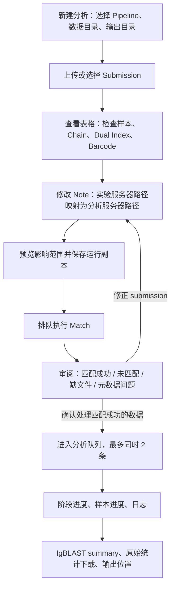

# Web 操作流程优化方案

日期：2026-09-07。状态：待实施；本轮只制定方案。

## 1. 范围与原则

- 沿用 FastAPI、SQLite、原生 JS、Docker，以及四条 pipeline 的现有 runner。
- 补全 submission 上传/查看/编辑、Note 路径转换、Match 审阅、流程介绍、进度和 IgBLAST summary 展示。
- pipeline 的计算定义、过滤规则、代表序列/UMI 处理及模型公式不改；线程数、workers 等仍由各自 `00.pipeline_config.env` 管理，前端不提供调参。
- Web 全局最多同时执行 2 个 pipeline 任务。队列和等待审核不占执行名额；Match 运行、下游运行和停止中的进程占名额。
- 本期保持单个 Web 服务实例、单个 Uvicorn worker；不引入 Redis、Celery 或平台化账户系统。

## 2. 实际证据与优先修复

| 当前事实 | 对操作流程的影响 | 计划处理 |
|---|---|---|
| 示例工作表 `20230714` 有表头及 27 条样本，Note 合并区域 `N2:N28`，N2 为 `/colddata/zqy/XYFY_HZJ/230714` | Note 不是只有首行样本拥有 | 按合并区域显示、编辑并预览受影响样本 |
| `web/static/index.js` 调用 `loadPipelines()`，当前文件没有该函数定义 | Pipeline 列表初始化可能直接失败 | 恢复加载函数、失败提示；进行真实浏览器测试 |
| `web/templates/index.html` 的 pipeline select 在 form 外且未通过 form 属性关联 | FormData 缺少 pipeline，提交和验证可能返回 422 | 明确表单归属，测试四种选择提交的 payload |
| `web/app.py:schedule` 检查名额与启动进程之间释放锁 | 并发请求可能重复启动任务或突破上限 | 原子占位和启动，幂等确认/续跑 |
| MAX_ACTIVE_JOBS 仅取 max(1,配置)，未限制最大值 | 管理员配置大于 2 可突破需求 | 服务端明确限定范围 1–2，默认 2 |
| Match API 只返回前 100 行，页面在这 100 行内筛错误 | 后面的错误不可审阅 | 服务端全量筛选后分页，独立总数 |
| 通用 resume 可对 WAITING_REVIEW 生效，confirm 只改状态 | 审核可能被绕过；修改表后旧审核可能仍有效 | 审核绑定 submission 与 Match 版本，收紧状态转移 |
| parse_progress 每轮 read_text 全日志后截尾；阶段百分比直接当总进度 | 大日志耗时，阶段完成看似全任务 100% | 有界增量读取，阶段百分比与总阶段数分开 |
| launch_job 丢弃 stdout/stderr | runner 在日志初始化前失败时缺乏诊断 | 每次 attempt 保存 launcher 日志并展示错误摘要 |
| artifacts 只有 Match、日志和 state | 看不到最终比对统计 | 增加受限结果目录与 chain_summary API |
| requirements 仅 FastAPI/Uvicorn/Jinja2 | 当前镜像不能据此保证 XLSX 编辑和分析 Python 依赖齐全 | 加入 XLSX/上传必要依赖；核对实际分析运行环境并做容器冒烟测试 |
| Docker 整个容器 mem_limit=300g，而部分 pipeline 单任务预算为 300GB | 两任务上限不等于总内存安全保证 | 保留脚本参数及现有内存监控，展示聚合资源状态，双任务验证总内存行为 |

## 3. 完整用户流程

页面结构：任务控制台 + 新建分析分步表单 + 任务详情。
新建流程使用清晰步骤：流程与数据 → Submission 与 Note → 配置确认 → Match。
详情页使用：概览/流程、Submission、Match 审阅、执行日志、结果统计、操作记录。
原有文件树用于选择服务器路径；增加单独的本地 XLSX 上传入口，清楚区分二者。

## 4. Submission 上传、编辑与路径映射

### 存储与编辑

- 上传 .xlsx 或选择服务器已有 .xlsx/目录；目录先列出具体工作簿供确认，可使用多份。
- 原文件只读保存；编辑写入 Web 管理的运行副本，保留来源文件名、工作表名、Excel 行号、Note 锚点/合并区域。
- 推荐 `web/runtime/submissions/<submission_id>/original.xlsx` 与 `revisions/<revision>/effective.xlsx`，由现有 runtime 挂载持久化。
- 后端内部通过 submission_id/revision 解析文件，不开放任意 runtime 路径浏览，也不把运行副本拦在原 `/colddata` 校验之外。
- 新任务及每次重新 Match 绑定确定版本；正在分析的任务不可更换其输入版本。原始上传、副本下载均有明确入口。
- 用 XLSX 读写库编辑 Note 锚点，保留其他列及合并区域；不把整张表经过 CSV 再重建。
- 前端表格查看所有原字段，重点展示 Sample ID、Dual Index、Barcode、Species/Speicies、Chain、Note。第一期以 Note 编辑为主，支持用于补齐匹配的这些元数据字段编辑；不做任意 Excel 排版编辑器。
- 文本标识符保留字符串，不把前导零、希腊字母或 Chain 文本转为数字/其他值。

### Note 操作

- 合并 Note：例如 N2:N28 显示“共用路径，影响 27 个样本”，编辑一次应用于整个区域。
- 非合并空白 Note：区分物理空白与当前 matcher 的继承结果；预览明确标注继承来源，不擅自改变分组范围。
- 支持整组选择新目录，以及按路径组成部分进行前缀替换：旧根 → 新根，保留相对子路径。
- 执行前预览旧路径、新路径、影响样本数、服务器目录是否存在、是否与所选数据目录有对应关系。
- 多组 Note 映射独立配置；不把不同批次无条件替换成同一个目录。不按 submission 文件名与数据目录名配对。
- 新路径经 realpath、允许根目录及目录存在性校验；目录存在不代表样本匹配成功，实际匹配仍由第一阶段完成。
- 兼容实际 Note 列名 `Note（数据文件储存地址）`、`Speicies` 拼写、合并单元格及多工作表；有效导出与四个 matcher 的字段解析一致。

## 5. Match 审阅与修正闭环

- 页面展示：FASTQ 文件对数、匹配记录数、成功样本数、异常文件对数；混样多行和 R1/R2 不能简单累加为样本数。
- 使用标准 summary/manifest 为执行事实来源；如有旧版 read-level CSV，展示层聚合配对，不能同时重复累计两个 summary。
- 服务端支持 status、原因、样本、文件路径、Note、dataset 筛选及分页，默认 50 行；所有匹配记录均可查看。
- 主表列为 Note/数据集、原文件对、Sample ID、Chain、Dual Index、Barcode、匹配方式、状态、原因、审阅标记。
- 将“系统匹配状态”和“人工审阅标记”分开。标记为已核对/待补资料并附备注，不能把 ERROR 手工涂成 OK 驱动分析。
- 标记存 SQLite，键包含任务、版本和具体文件对/样本身份；同名 sample 不跨目录合并。
- 系统错误保留原文本，展示原因分类；缺 R2、Note 不匹配、Barcode 缺失不混成一个笼统 unmatched 数。
- submission 中有登记但原数据未发现的样本单独展示，作为完整性核对；不将其强行加入可执行文件清单。
- 存在 OK 与 ERROR 时可明确确认“仅处理匹配成功的数据”；OK=0 禁止下游。
- 修改 Note/补齐元数据后需重新 Match，旧确认失效；新结果显示新增、消失和变化的匹配记录。
- 首次只 Match 继续调用既有 runner 机制；实现时核对四个 runner 的 review marker 契约。若需补充 Web 调用的明确 match-only 控制，只做必要接口调整，禁止依靠普通 resume 绕过审核。
- 更改已经分析过样本的映射与“新增漏登记样本”分开处理：前者不能复用旧 checkpoint 作为新结果，使用新的输出目标/运行；后者利用原样本级断点补跑。

## 6. 四种流程介绍与进度

| Pipeline | 面向使用者的流程介绍 |
|---|---|
| IR raw / representative | Match → fastp → Barcode 拆样并提取 UMI → clean → PANDAseq → 样本内按 UMI 代表序列 → IgBLAST → preprocessing（按配置） |
| IR presplit | Match → fastp → 已拆分数据导入/提取 header UMI → clean → PANDAseq → 代表序列 → IgBLAST → preprocessing（按配置） |
| IR merged | Match → fastp → 拆分或导入 → clean → PANDAseq → 直接 IgBLAST；不显示代表序列为未完成 |
| 10X | Match → fastp → R1 TSO/R2 Barcode 预筛选 → clean → PANDAseq → Barcode+UMI 代表序列 → IgBLAST → chain cluster |
| IgBLAST base | Match/Chain 检查 → fastp → clean → PANDAseq → IgBLAST |
| Pig IgBLAST | Match/Species与Chain检查 → fastp → clean → PANDAseq → 猪数据库 IgBLAST |

- 以 `pipeline_registry.json` 为 Web 阶段介绍的集中配置；每阶段维护说明、适用模式、状态标识和结果路径。
- 流程图可用现有 HTML/CSS 节点与连线，不引入前端框架；点击节点展示输入、处理内容、输出。
- 介绍中说明 IR Barcode 对应样本，10X Barcode 对应细胞；计算细节以现行脚本为准。
- 区分等待/运行/成功/失败/跳过；按实际输入模式显示适用阶段。不能用固定 8 阶段解释所有 IR 模式。
- 总流程展示“完成 3/7 阶段”；当前阶段展示样本任务 completed/total 及百分比。阶段 100% 不能冒充整个流程完成，也不显示无依据的预计剩余时间。
- DONE marker 和最终产物校验优先；日志仅辅助进度。后端有界增量读取，前端同一任务只保留一个日志请求，处理日志截断/重跑。

## 7. IgBLAST 结果浏览

- 在 registry 中声明实际结果位置：IR representative 与 10X 为 `07.igblastn_out/<dataset>`，IR merged 为 `06.igblastn_out/<dataset>`，Base/Pig 为 `05.igblastn_out/<dataset>`；实现时核对 runner 的 stage_root。
- 首选各自 `chain_summary.csv`，兼容现行 `igblast_summary.tsv` 等已核实格式；批次级 run summary 单独显示，禁止与样本汇总相加。
- 统一展示 dataset、样本/来源路径、chain、input_sequences、mapped_seqs、mapping_percent、productive_seqs、filtered_seqs、filtered_percent、status、error。
- mapping 是匹配到 V 的数量；filtered 是按既有 productive/V-call 规则最终保留数量。界面读取统计，不重新定义计算。
- input=0 且 mapped>0 标注“统计异常”；缺失值显示未提供，不伪装成 0。保留脚本原字段供展开查看。
- 同一 FASTA 可能送入多条链；不把跨链 input 或 mapped 相加当作唯一序列总数，不直接平均 mapping 百分比。
- 按 dataset/样本/chain 筛选、分页，下载原 summary；输出文件按任务实际目录显示。IgBLAST 后还有 preprocessing/cluster 时可显示已生成的 IgBLAST 结果，同时保留任务正在运行状态。
- 下载只允许本任务已登记的结果文件，读取大文件流式处理。

## 8. 调度、资源与部署

- 严格限制 max_active_jobs <= 2；第三个任务排队，确认 Match/续跑走同一队列。
- 当前单实例下将检查容量、条件认领 QUEUED、启动并登记进程放入一次受锁保护的流程，启动失败释放占位；同一任务重复请求只产生一个进程。
- 等待 Match 审阅释放执行位；STOPPING 在进程组真正退出前不释放。排队取消、停止与启动的竞争必须有测试。
- 运行输出目录+dataset 冲突阻止并行；同一输出允许不同 dataset 的前提是既有阶段写入范围确实独立。
- 保持单 Uvicorn worker 和单 Web 实例，明确这是全局限制的部署前提；重启时恢复任务状态，不能双重调度或误把审核任务当续跑任务。
- Web 不改 pipeline 内的 threads、workers、每阶段内存配置。只显示部署上限 2 和运行槽位 0/2、1/2、2/2。
- 当前 300g 是整个容器总限额，不是每条 pipeline 各 300GB；因此无法承诺两条高内存任务必然能同时完成。保持总限额与脚本当前实时内存监控，部署验收检查是否识别 cgroup 可用内存；如果仅识别宿主机空闲内存，列为上线前必须处理的启动/资源控制问题，不以暗改线程数解决。
- 两任务并发是否满足总预算由实际阶段测试确定；若不满足，可由管理员先将 Web 槽位设为 1，仍符合“最多两条”，不得擅自将共享内存上限提升到 600GB。
- 上传依赖及 pipeline 分析依赖分别核对。上传必要支持包括 XLSX 读写与 multipart；实际分析需要的 Python 库、fastp/PANDAseq/IgBLAST及数据库均需在容器内可见，启动前显示具体缺项。
- 将允许根目录与实际挂载对应起来；仅在 .env 填写一个未被 Compose 引用的变量不会生效。上传目录走专用内部解析，避免放宽整个服务器浏览权限。
- deploy.sh 更新不能在活跃任务期间直接 force-recreate，默认检测到正在运行任务时退出并说明原因；审核版本和上传副本在重建后仍保留。

## 9. 实施顺序与文件

1. 修复前端初始化/表单提交、调度竞态及日志丢失，建立可靠提交和两槽队列。
2. submission 上传、工作簿查看、Note 合并区域和路径映射、运行副本版本化。
3. Match 全量分页、原因筛选、审阅备注、重新 Match 与版本确认门槛。
4. 四流程介绍及动态流程图、准确进度；补齐最终 chain_summary 浏览与下载。
5. Docker 依赖/挂载验证、部署保护、完整浏览器与 runner 接口联调。

主要修改 `web/app.py`、`web/static/index.js`、`web/static/job.js`、`web/static/style.css`、两份 templates、`web/pipeline_registry.json`、`web/requirements.txt`、`web/Dockerfile`、`web/docker-compose.yml`、`web/.env.example`、`web/README.md`、`deploy.sh`。
XLSX 读写和 Note 修改集中在一个 `web/submission.py`，必要时新增 `web/static/submission.js`，避免把工作簿处理全部堆进 app.py。其余继续使用现有结构。
四个 runner 仅在实际联调证明 Match-only/确认接口不满足时做最小调整，不重构分析阶段。

## 10. 验收

- 示例 N2:N28 的 27 样本批量换路径，原始工作簿不变，运行副本除目标修改外保持一致；导出后 matcher 读出的 Note 对 27 行一致。
- 多工作表、多 Note、非合并空白 Note、重复 Dual Index、中文路径、错误类型、越界路径和目录无权限均有明确结果。
- 101 行以上的 Match，错误出现在第 101 行后仍能筛到；混样多行不夸大文件对数量；全 ERROR 不能继续。
- 改 Note 后拒绝旧版本确认；resume 不绕过审核；新增匹配样本可补跑，未变样本由 checkpoint 跳过。
- 4 种 pipeline 均能选择并提交正确 payload，浏览器无初始化异常；文件树返回、取消、选择后填值有效。
- 同时创建/确认/续跑多个任务，活跃 runner 永不超过 2、同一 job 永不双启；停止/取消/重启过程不遗留占位。
- 用测试 runner 验证队列、审核与状态机；用四类小 FASTQ/测试 submission 和实际工具各跑一次，检查 Match、阶段输出、summary 与界面对应。
- 阶段百分比重置不误报整体完成；IR merged 跳过代表序列及默认 preprocessing，最终完成状态正确。
- summary 展示数值与原文件一致，跨链/跨样本不重算；缺统计文件显示未生成而非全 0。
- 两任务资源验收明确宿主机、容器、进程组限制的实际关系；不将 max2 当作内存测试通过的替代。

本期交付以“数据准备 → Match 审核 → 最多两条分析 → 结果统计查看”闭环可用为准。

## 实施记录（2026-09-07）

已实现 Web 工作副本上传/导入、按合并 Note 编辑、前缀替换预览、目录浏览、版本导出；完整 Match 分页/搜索/标记、版本确认、重新 Match 和已确认映射保护；四流程介绍、动态阶段进度、IgBLAST summary 分页下载；两槽调度互斥、部署前运行任务检查及环境缺项提示。四个 runner 只增加明确的 Web match-only 条件，模型和内部并发参数未改。

已验证：10 项隔离自动化测试（含 27 行合并 Note、150 行之后的 ERROR、审核与断点保护、并发抢占）；Playwright 桌面/窄屏交互，四类型提交字段、工作副本、创建、匹配筛选和结果展示均通过；Python/JavaScript 与四 runner/deploy.sh 语法检查通过。

边界：登记核对显示“提交表有记录但清单未识别”，不将其误报为磁盘物理文件缺失。原始工作簿不覆盖。真实 FASTQ 四流程、Docker 镜像运行及两任务峰值/cgroup 内存未在本机验收，需在部署服务器执行；300g 仍是容器共享预算。分析 Python 环境继续由部署的现有工具环境提供，未擅自升级计算库版本。
